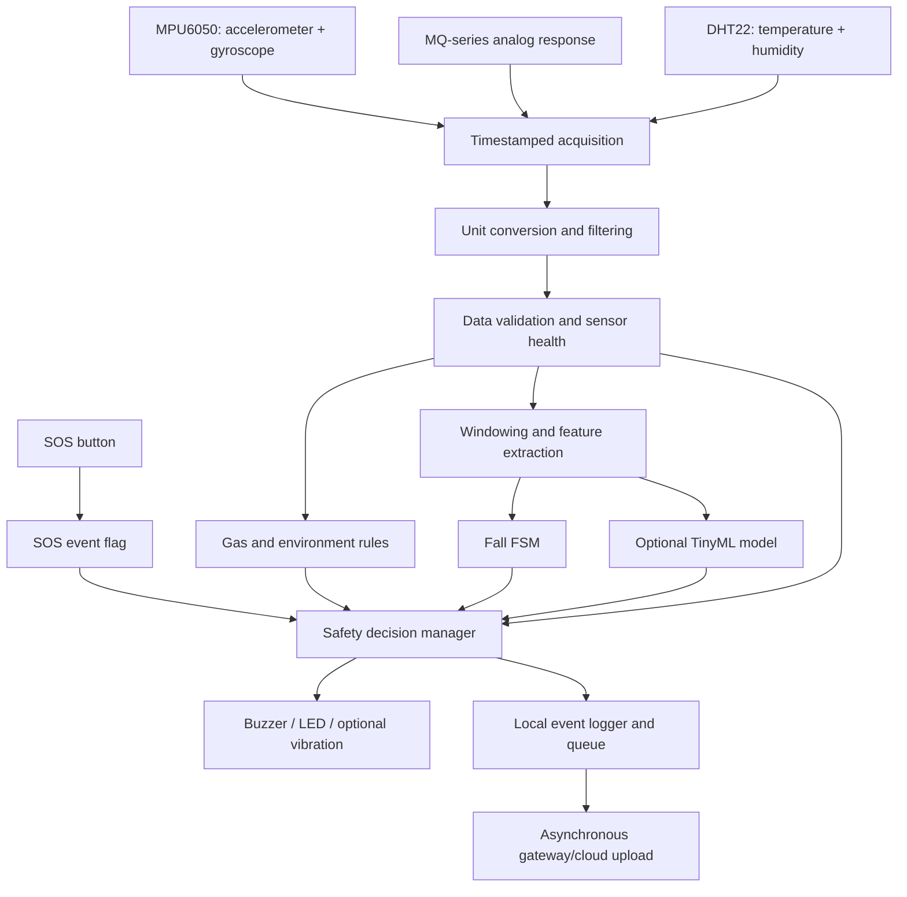

# SENTINEL-X — Edge Processing Architecture

> **Purpose:** Specify what runs locally on the ESP32 wearable node, what data it produces, and what is sent to the gateway/cloud for heavier processing.
>
> **Design boundary:** Edge processing covers acquisition, preprocessing, validation, feature extraction, immediate safety rules, optional TinyML inference, local outputs, and offline buffering. Cloud processing may enrich analysis, but it must never be required to activate a local SOS or validated emergency alert.
>
> **Scope note:** Oxygen-deficiency detection is out of scope. An MQ-series sensor does not automatically provide a reliable gas identity or ppm measurement. This prototype must not be represented as a certified confined-space life-safety system.

---

## 1. Edge-processing objectives

- Read the wearable sensors on a predictable schedule.
- Convert raw measurements into useful physical units and derived features.
- Detect invalid readings and report sensor health separately from hazard status.
- Detect fall-like events locally using a transparent finite-state machine (FSM).
- Apply only validated, configured gas/environment rules locally.
- Trigger SOS and local alerts without Wi-Fi or cloud inference.
- Buffer important events during network outages.
- Send compact periodic telemetry and richer event records to the gateway/cloud.

## 2. High-level architecture



## 3. What runs on the ESP32?

| Function | Edge responsibility | Cloud/gateway responsibility |
|---|---|---|
| Sensor acquisition | Read sensors and timestamp samples | Store historical telemetry |
| Signal processing | Filtering, unit conversion, basic features | Deeper signal analysis if needed |
| Validation | Range, stale, missing, stuck, and sensor-health checks | Fleet/device health trends |
| Fall detection | FSM and optional small model | Offline training, model evaluation, historical analysis |
| Gas response | Sensor warm-up/validity and calibrated local rules | Trend analysis and longer-term forecasting |
| Temperature/humidity | Validity and configured local warning rules | Historical trends and contextual analytics |
| Alerting | SOS, local hazard decision, buzzer/LED | Dashboard, notifications, supervisor view |
| Storage | Recent RAM buffer and persistent critical-event queue | Long-term database and reporting |
| ML lifecycle | Run a measured, compact model if enabled | Train, validate, explain, and version models |

**Invariant:** The ESP32 must remain able to trigger SOS and local rules if Wi-Fi, MQTT/HTTP, the gateway, or cloud inference is unavailable.

## 4. Suggested sampling schedule

| Input | Initial target rate | Notes |
|---|---:|---|
| MPU6050 accelerometer + gyroscope | 50 Hz | Primary fall/motion stream |
| MQ-series ADC response | 1 Hz | Start with relative response; validate the actual sensor and circuit |
| DHT22 | 0.5 Hz maximum | Use at least 2 seconds between reads |
| SOS button | Interrupt or frequent polling | ISR should set a flag only |
| Device health | 0.2 Hz | Battery, uptime, RSSI, queue use, sensor status |

These are implementation targets to validate against the actual board, libraries, and timing budget—not universal sensor requirements.

## 5. Acquisition and unit conversion

### 5.1 MPU6050

1. Read accelerometer and gyroscope samples with timestamps.
2. Convert raw counts using the configured full-scale ranges and library settings.
3. Example configuration from the design: accelerometer ±8 g (4096 LSB/g) and gyro ±500 °/s (65.5 LSB/(°/s)); verify these values against the actual register configuration.
4. Estimate gyro bias while the device is stationary and subtract it.
5. Detect missing reads, I²C failures, and timing gaps.

### 5.2 MQ-series sensor

1. Read the analog output using a suitable ADC pin for the specific ESP32 variant.
2. Ensure the sensor's analog output is scaled to stay within the ESP32 ADC input limit.
3. Average a group of ADC samples (for example, 16) to reduce noise.
4. Track warm-up, baseline, raw ADC, voltage, response change, and rate of change.
5. Keep concentration in ppm unknown/null unless the exact sensor, target gas, circuit, and calibration support the conversion.

### 5.3 DHT22

1. Read temperature and relative humidity at a supported rate.
2. Check for failed, stale, or out-of-range readings.
3. Mark failed readings invalid instead of reusing them indefinitely.

### 5.4 SOS

- Debounce the button and implement the configured press/long-press policy.
- Keep the interrupt handler short: set a flag or enqueue a minimal event.
- Handle the actual emergency action in the safety task, not inside the ISR.

## 6. Signal preprocessing

- **IMU:** low-pass filtering or moving average/EMA, gyro-bias correction, unit conversion, acceleration magnitude, gyro magnitude, tilt estimation, and jerk.
- **MQ response:** ADC averaging, voltage conversion, EMA smoothing, baseline-relative change, and rate of change.
- **DHT22:** validate readings and optionally compute temperature/humidity rate of change.
- Keep both raw or lightly processed diagnostic samples and processed values when storage permits, so thresholds can be evaluated later.
- Avoid excessive smoothing that hides short impacts or delays an urgent alarm; verify filter delay on recorded signals.

## 7. Validation and sensor-health gate

Track these as separate fields:

- `measurement_valid`
- `sensor_health_status` (`OK`, `DEGRADED`, `FAULT`, `UNKNOWN`)
- `anomaly_detected`
- `hazard_detected`

Checks include:

- NaN, out-of-range, missing, stale, or implausible values.
- Stuck readings and abnormal noise.
- IMU/I²C errors and missed sampling deadlines.
- MQ warm-up/calibration status, ADC saturation, and drift.
- DHT22 failures and stale values.
- Battery, queue capacity, watchdog resets, and network state.

An invalid sensor reading is not a safe reading. A sensor fault is not itself proof of a physical hazard. When a channel is invalid, mark the corresponding detection capability as unavailable and raise a health event according to policy.

## 8. Windowing and feature extraction

### IMU windows

- Sampling: 50 Hz.
- Window: 2 seconds = 100 samples per channel.
- Overlap: 50%, producing a 1-second stride.
- Optional CNN tensor: `100 × 6` (accelerometer XYZ and gyroscope XYZ), using a consistent training-time normalization method.

Candidate features:

- Acceleration magnitude: `SVM = sqrt(ax² + ay² + az²)`.
- Gyroscope magnitude.
- Per-axis mean, standard deviation, variance, range, RMS, and energy.
- SVM minimum/maximum and impact peak.
- Jerk and peak jerk.
- Tilt and tilt change.
- Post-event motion variability over 5–10 seconds.
- Time from a possible free-fall dip to an impact.

A direct SOS event must not wait for a complete IMU window.

### Gas/environment features

- ADC average and voltage.
- Baseline-relative response and response rate.
- Duration above a validated threshold.
- Temperature/humidity and their rates of change.
- Warm-up, calibration, validity, and health flags.

## 9. Local detection paths

### 9.1 Fall detection FSM

Use a transparent FSM as the baseline:

`IDLE → FREE_FALL_CANDIDATE → IMPACT_CANDIDATE → ORIENTATION_CHANGED → POST_FALL_INACTIVITY → FALL_ALERT`

Candidate starting values from the design:

| Signal | Starting point only |
|---|---:|
| Possible free-fall | SVM < 0.5 g |
| Impact | SVM > 2.5–3 g within about 1 second |
| Orientation change | Tilt change > 60° or supporting gyro evidence |
| Post-event inactivity | SVM standard deviation < 0.05 g for 5–10 seconds |

These are not validated safety limits. Calibrate with representative data, device mounting, and non-fall activities. A single threshold must not confirm a fall.

Possible model labels: `normal_activity`, `rapid_non_fall`, `fall_impact`. Treat post-fall inactivity as an FSM state unless the dataset design justifies a separate classifier label.

### 9.2 Optional TinyML

- Begin with the FSM and a small tree model as the baseline comparison.
- Consider a compact int8 1D-CNN only after measuring performance.
- The model may provide additional evidence or raise concern; it must not suppress SOS or validated hard-rule alarms.
- Measure actual inference time, RAM, flash use, and energy on the selected ESP32.
- If inference fails or exceeds its budget, fall back to the FSM and rules.

### 9.3 Gas and environment rules

- Verify sensor presence, warm-up, calibration, and valid measurement state first.
- Use only thresholds derived from the exact sensor, target gas, calibration, and applicable requirements.
- Use persistence/hysteresis only where appropriate and never introduce an unsafe delay to a required response.
- Do not invent ADC-to-ppm conversion.
- MQ sensors may be cross-sensitive and drift with environment and age; do not treat an uncalibrated MQ sensor as the sole life-safety gas detector.
- Oxygen-deficiency detection is not included.

## 10. Safety decision manager

All local detectors submit events to a single safety manager. Preserve each active event; select the output pattern based on the highest-priority active event.

Suggested priority policy:

1. SOS — immediate emergency.
2. Confirmed fall with supporting evidence.
3. Validated critical gas hazard.
4. Danger/caution — suspected fall, prolonged inactivity, or environmental warning.
5. Device-health event — invalid sensor, low battery, or connectivity loss.

The precise ordering among non-SOS emergencies must be defined by the validated hazard policy. Priority arbitration must not suppress another validated emergency.

### Pseudocode

```text
on_sos():
    latch SOS event
    activate local alarm immediately
    persist event
    queue upload without waiting for network

on_detector_event(event):
    record event

    if event is a validated emergency:
        latch event
        activate/update local alarm
    else:
        update caution or health state

    persist event
    enqueue asynchronous upload

safety_task():
    process SOS flag and detector events
    preserve all active emergencies
    select the highest-priority active output pattern
    clear only through the documented condition/reset policy
```

## 11. Local alert outputs and lifecycle

| State/event | Suggested local output |
|---|---|
| SOS | Continuous or rapid repeating buzzer |
| Confirmed fall | Repeating high-priority pattern |
| Critical gas | Distinct repeating emergency pattern |
| Caution | Short intermittent beeps |
| Sensor fault | Periodic diagnostic indication |
| Normal | Silent |

Test audibility and distinguishability in the intended environment. A buzzer does not guarantee that a remote responder has received the alert.

### Latching and reset

- Enter an alert when its detector's validated trigger criteria are met.
- Keep it active while the condition persists.
- Record acknowledgement separately from clearing.
- Do not clear an emergency merely because it was acknowledged.
- Clear only after the condition and reset requirements are satisfied.
- Revalidate a sensor before marking a recovered channel healthy.
- An optional fall-only cancellation window may be evaluated; never apply it to SOS or validated critical gas alarms.

## 12. Event records and local buffering

Store a compact event record containing:

- Device ID, monotonic sequence number, timestamp or uptime.
- Event type, severity, detector source, and reason flags.
- Sensor validity/health snapshot.
- Local alarm state and acknowledgement state.
- Cloud synchronization state.

Storage strategy:

- RAM ring buffer for recent samples.
- Flash-backed storage for critical events, using a suitable wear-aware mechanism.
- Upload critical events before routine telemetry after reconnection.
- If the queue fills, discard/downsample routine telemetry before critical events and report a storage-health warning.
- Test reset and power-loss behavior for the selected storage implementation.

Example event:

```json
{
  "device_id": "SENTINEL_X_001",
  "sequence": 1042,
  "timestamp_ms": 1830000,
  "event_type": "FALL_CONFIRMED",
  "severity": "EMERGENCY",
  "source": "FALL_FSM",
  "reason_flags": [
    "IMPACT_DETECTED",
    "ORIENTATION_CHANGED",
    "POST_EVENT_INACTIVITY"
  ],
  "sensor_health": {
    "imu": "VALID",
    "gas": "UNKNOWN",
    "environment": "UNKNOWN"
  },
  "local_alarm_active": true,
  "cloud_synced": false
}
```

This payload is illustrative, not a real sensor reading.

## 13. FreeRTOS task layout

| Task | Responsibility |
|---|---|
| `sensor_task` | Timestamped IMU acquisition at 50 Hz; never blocks on Wi-Fi |
| `gas_env_task` | MQ and DHT22 reads, validity, and local rules |
| `ml_task` | IMU feature extraction and optional inference per window |
| `safety_task` | SOS, event arbitration, latching, buzzer/LED |
| `storage_task` | Persist critical events and manage queue |
| `comms_task` | Wi-Fi/MQTT/HTTP, reconnect, upload queued records |
| `health_task` | Battery, uptime, RSSI, sensor errors, queue usage |

These are logical tasks; confirm core assignment, priorities, stack sizes, and timing with measurements on the actual board. Use queues/thread-safe flags between tasks. Avoid blocking operations in sampling and safety tasks. The SOS ISR must do minimal work.

## 14. Edge-to-cloud contract

### Edge must retain

- SOS activation.
- Fall FSM and local fall alert.
- Validated gas/environment hard rules.
- Sensor-health gating.
- Local output control and emergency latching.
- Critical event recording.

### Gateway/cloud may perform

- Longer-term gas/environment trends.
- Heavy anomaly detection (e.g., Isolation Forest or autoencoder).
- Cross-event and multi-device analytics.
- Training, evaluation, explainability, dashboards, and reporting.
- More expensive temporal models.

The cloud can add context or raise an alert according to a validated policy, but cannot suppress a local emergency. Configuration updates should be authenticated, versioned, range-checked, and applied safely.

Suggested upload behavior:

- Periodic compact telemetry for normal operation.
- Immediate queueing of event metadata when a local event occurs.
- Richer pre-event/post-event samples for important events, subject to buffer capacity.
- Retry after reconnect; deduplicate using device ID and sequence number.
- Continue local operation if all upload attempts fail.

## 15. Reliability behavior

| Failure | Edge behavior |
|---|---|
| Wi-Fi/cloud outage | Local detection and alarms continue; buffer events |
| Gateway heartbeat lost | Report `NO SIGNAL` remotely; never infer the worker is safe |
| IMU fault | Mark fall detection unavailable; keep SOS and other valid paths active |
| MQ warming/un-calibrated | Mark gas channel unknown; do not claim gas safety |
| DHT22 failure | Bounded retries, then invalid status |
| ML failure/timeout | Fall back to FSM/rules |
| Low battery | Raise health warning and preserve emergency capability where possible |
| Buffer full | Preserve critical events preferentially; report storage fault |
| Watchdog/reset | Restart safely and report reboot; recover queued events where possible |

## 16. Testing and acceptance criteria

Test with recorded/replayed signals and controlled hardware tests. Do not expose people to hazardous gases or dangerous fall conditions for testing.

- [ ] SOS triggers with Wi-Fi disabled.
- [ ] Sensor sampling continues while the network is down.
- [ ] A simulated confirmed fall follows the intended FSM and alert path.
- [ ] Rapid non-fall movement is tested for false alarms.
- [ ] Invalid or stale data is marked unavailable rather than safe.
- [ ] MQ warm-up and calibration gates behave correctly.
- [ ] An active emergency is not overwritten by a lower-priority event.
- [ ] Acknowledgement does not clear a persisting hazard.
- [ ] Critical events survive the intended outage/reconnect workflow.
- [ ] Inference, storage, and communication do not break sampling deadlines.
- [ ] Power/reset and low-storage cases are tested.
- [ ] On-device latency, RAM, flash, and energy use are measured.

Evaluate fall models using subject-wise train/validation/test splits, not random splits of overlapping windows. Track event recall, missed falls, false alarms per worker-hour, precision/recall, macro F1, detection latency, inference time, and memory use. If ML does not beat the rule baseline on held-out subjects, retain the simpler baseline.

## 17. Development sequence

1. Bring up sensors, SOS button, buzzer, and power.
2. Implement timestamped acquisition and CSV/serial logging.
3. Add filtering, conversion, validation, and sensor-health states.
4. Implement SOS and the local safety manager.
5. Implement and replay-test the fall FSM.
6. Add MQ calibration/warm-up logic and validated gas rules.
7. Add DHT22 validity and environmental warning rules.
8. Add event buffering and asynchronous cloud sync.
9. Evaluate a small model against the FSM baseline; deploy only if measured performance justifies it.
10. Run fault injection, timing, power, and end-to-end acceptance tests.

---

## 18. Non-negotiable design rules

- **No cloud dependency for SOS or local validated emergency alerts.**
- **ML cannot suppress or delay SOS or validated hard-rule alarms.**
- **Invalid sensor data is unknown, not safe.**
- **An anomaly is not automatically a hazard.**
- **No invented gas ppm conversions or unvalidated safety thresholds.**
- **Oxygen-deficiency detection remains out of scope.**
- **This is a prototype design, not a certified life-safety device.**
