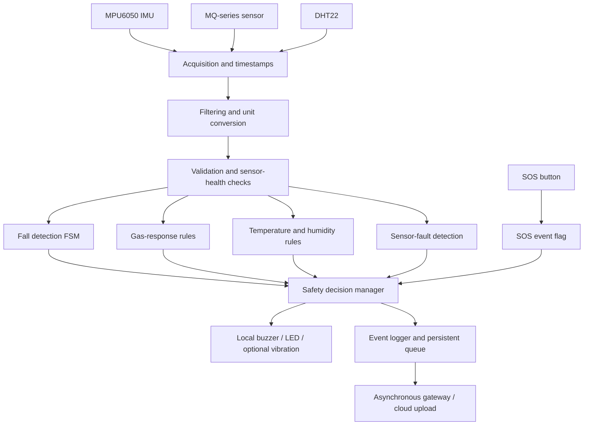
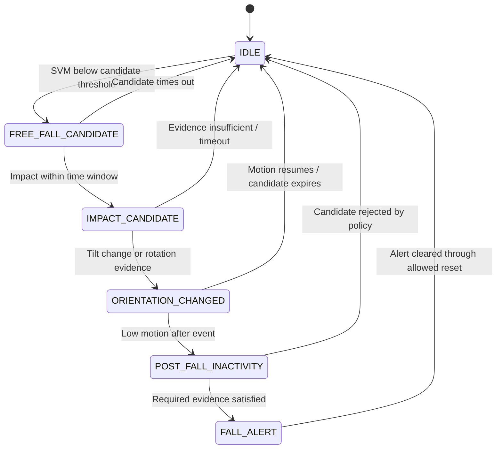
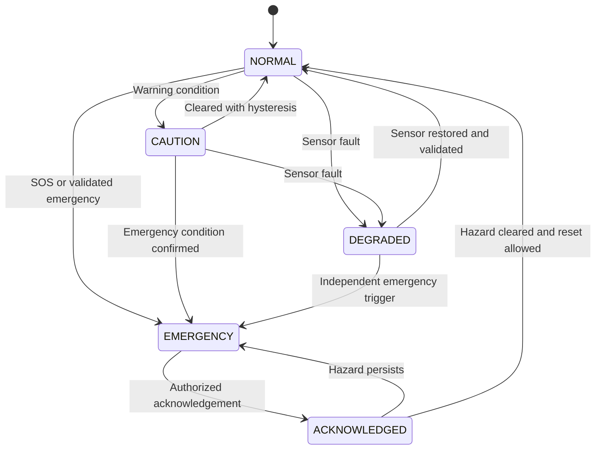

# SENTINEL-X — Local Alert Pipeline

> **Purpose:** Define the ESP32-side alert pipeline for SENTINEL-X, an IoT safety prototype for confined-space workers. Local safety decisions must continue when Wi-Fi, the gateway, or cloud services are unavailable.
>
> **Scope:** Fall detection, configured MQ-series gas-response alerts, temperature/humidity warnings, SOS, sensor-health monitoring, local annunciation, event logging, and asynchronous cloud synchronization.
>
> **Out of scope:** Oxygen-deficiency detection. SENTINEL-X, as described here, cannot determine whether a confined space is safe to enter. This prototype is not a certified life-safety system.

---

## 1. Design principles

1. **Local-first:** SOS and configured safety rules execute on the ESP32. Do not wait for the cloud, dashboard, or network.
2. **Rule-first safety:** Hard safety rules remain authoritative. TinyML may assist detection or increase concern, but must never suppress, delay, or clear an SOS or validated life-safety alarm.
3. **Separate concepts:** Keep measurement validity, sensor health, anomaly detection, and hazard detection as separate states.
4. **Fail visibly:** A failed or uncalibrated sensor must be marked unavailable/unknown—not interpreted as a safe reading.
5. **Prioritize events:** A new lower-priority event must not overwrite an active emergency.
6. **Latch emergencies:** Acknowledgement is not the same as clearing the hazard.
7. **Store and forward:** Record critical events locally and upload them when connectivity returns.
8. **Validate thresholds:** All numerical values in this document are development starting points, not certified safety thresholds.

## 2. System architecture



### Main pipeline stages

1. Timestamped sensor acquisition.
2. Unit conversion, filtering, and baseline handling.
3. Data validation and sensor-health assessment.
4. Parallel detector execution.
5. Safety decision and priority arbitration.
6. Immediate local alert output.
7. Event logging and store-and-forward queue.
8. Asynchronous cloud synchronization.

## 3. Hardware and sampling plan

| Input | Suggested rate | Local responsibility |
|---|---:|---|
| MPU6050 accelerometer + gyroscope | 50 Hz | Fall/motion detection |
| MQ-series analog output | 1 Hz initial target | Relative sensor response and configured gas rules |
| DHT22 temperature/humidity | At most 0.5 Hz | Environmental warnings and context |
| SOS button | Interrupt or frequent polling | Immediate SOS request |
| Device health | About 0.2 Hz | Battery, uptime, connectivity, buffer, sensor status |

### 3.1 MPU6050

- Suggested starting ranges: accelerometer ±8 g and gyroscope ±500 °/s, subject to the actual library/configuration.
- Convert raw values to physical units using the configured sensor scale.
- Measure gyro bias while the device is stationary at startup; subtract the bias from subsequent samples.
- Apply a suitable digital low-pass filter or moving average/EMA.
- Derive acceleration magnitude (SVM), gyro magnitude, tilt, jerk, and window statistics.
- Check I²C reads, sample timing, range, missing samples, and implausible/stuck values.

### 3.2 MQ-series gas sensor

- Identify the exact MQ model and intended target gas before choosing a threshold.
- The MQ heater may require 5 V. Ensure its analog output is scaled so the ESP32 ADC input never exceeds the board's permitted voltage (typically 3.3 V maximum).
- Prefer an ADC1 pin when Wi-Fi is used; confirm the exact ESP32 variant and pin mapping.
- Average multiple ADC readings to reduce noise; an initial example is 16 readings per reported value.
- Track warm-up status, baseline, drift, response change, and rate of change.
- Treat the reading as a **relative sensor response** unless a documented calibration supports concentration estimates.
- Keep `gas_concentration_ppm` null unless the sensor, target gas, calibration, and conversion are validated.
- MQ sensors can have cross-sensitivity, environmental effects, and drift. Do not use an uncalibrated MQ reading as the sole life-safety detector.

### 3.3 DHT22

- Read no faster than its supported update rate (use 2 seconds between readings as a starting point).
- Validate returned values and library/checksum errors.
- Mark failed or stale values invalid and retry according to a bounded policy.
- Temperature/humidity are environmental context; they are not a clinical diagnosis of heat stress.

### 3.4 SOS input and outputs

- Debounce the button and define its press/long-press behavior.
- The interrupt handler should only set a flag or enqueue a small event; it must not perform network operations.
- Drive the buzzer and LED from the safety/alert task.
- An optional vibration motor can provide a wearable alert, subject to the hardware design.

## 4. Preprocessing and validation

For every channel, track these separately:

- `measurement_valid`: the current measurement passes validity checks.
- `sensor_health_status`: `OK`, `DEGRADED`, `FAULT`, or `UNKNOWN`.
- `anomaly_detected`: unusual behavior requiring investigation.
- `hazard_detected`: a validated hazard rule has fired.

### Validation checks

- Missing, stale, NaN, out-of-range, or implausible values.
- Stuck readings and abnormal noise.
- IMU/I²C errors and missed sampling deadlines.
- Gas sensor warm-up, calibration state, ADC saturation, and baseline drift.
- DHT22 read/checksum errors.
- Low battery, watchdog resets, buffer saturation, and lost connectivity.

**Do not conflate states:** a sensor fault is not proof of a hazard; an anomaly is not automatically an emergency; an invalid reading is not evidence of safety.

## 5. Windowing and local features

### IMU windows

- Sampling rate: 50 Hz.
- Window duration: 2 seconds = 100 samples per channel.
- Overlap: 50%, giving a 1-second stride.
- Optional CNN input: `100 × 6` (accelerometer XYZ + gyroscope XYZ), after a documented normalization procedure.

Candidate features:

- SVM: `sqrt(ax² + ay² + az²)`.
- Gyroscope magnitude.
- Per-axis mean, standard deviation, variance, range, RMS, and energy.
- SVM maximum/minimum and impact peak.
- Jerk and peak jerk.
- Estimated tilt and tilt change.
- Post-event motion variability over 5–10 seconds.
- Time between a possible free-fall dip and impact.

Do not make the safety path depend on a full window if a direct SOS or other hard safety rule has already triggered.

### Gas and environment features

- ADC average and voltage.
- Calibrated sensor resistance/ratio only when the circuit and calibration support it.
- Change from baseline, EMA response, rate of change, and duration above configured thresholds.
- Gas sensor warm-up/calibration status.
- Temperature, humidity, and their rates of change.
- Sensor-health and validity flags for all fusion logic.

## 6. Fall detection state machine

A multi-stage finite-state machine (FSM) is the required baseline. TinyML is optional assistance.



### Initial tuning values only

| Signal | Candidate starting value |
|---|---:|
| Possible free-fall | SVM < 0.5 g |
| Impact | SVM > 2.5–3 g within about 1 second |
| Orientation change | Tilt change > 60° or supporting gyro evidence |
| Post-event inactivity | SVM standard deviation < 0.05 g for 5–10 seconds |

These values must be calibrated using representative data and the actual device mounting position. A single threshold must not confirm a fall.

Suggested labels for training/evaluation:

- `normal_activity`
- `rapid_non_fall`
- `fall_impact`

`post_fall_inactivity` is an FSM state, not necessarily a classifier class. `unknown` is a sensor-health gate, not a trained class.

### Optional TinyML

- Start with a small decision tree or random forest and compare it against the FSM baseline.
- A candidate small 1D-CNN may use input shape `100 × 6`, Conv1D layers, global average pooling, and a small dense output.
- Quantize only after evaluating accuracy and latency.
- Export trees with a suitable embedded inference tool, or use TensorFlow Lite for Microcontrollers for a compatible int8 neural model.
- Memory/latency goals must be measured on the actual ESP32. Do not assume a model fits or meets a deadline without testing.

## 7. Gas and environmental alert rules

1. Check that the sensor is present, warmed up, and in a valid calibration state.
2. Evaluate response against limits derived for the exact sensor and target gas.
3. Use appropriate persistence, hysteresis, and rate-of-change checks to manage noise.
4. Keep invalid/warming-up/un-calibrated data separate from normal readings.
5. Trigger the configured local response when a validated rule is satisfied.
6. Upload longer-term trends and contextual analysis to the gateway/cloud asynchronously.

**Critical limitation:** MQ-series sensors are not universally selective gas analyzers. Do not invent ADC-to-ppm conversions or exposure limits. Confirm sensor suitability and applicable safety requirements before treating any reading as a life-safety alarm. Oxygen-deficiency monitoring is out of scope in this design.

## 8. Safety decision manager

All detectors submit structured events to one safety manager. The manager maintains active events independently; it must not reduce an emergency because a lower-priority detector reports normal.

### Suggested priority

1. **SOS — immediate emergency**
2. **Confirmed fall with supporting post-event evidence**
3. **Validated critical gas hazard**
4. **Danger/caution** — environmental warning, suspected fall, or prolonged inactivity
5. **Device health** — sensor fault, low battery, connectivity loss

The precise ordering among non-SOS emergencies must follow the project's validated hazard policy. Do not let priority arbitration suppress a validated emergency from another detector.

### Event structure

Each event should include:

- Event ID and monotonic sequence number.
- Device ID and timestamp/uptime.
- Event type, severity, source detector, and reason flags.
- Sensor validity/health snapshot.
- Alert-active and acknowledgement state.
- Upload/synchronization state.

### Pseudocode

```text
on_sos_event():
    create SOS_EMERGENCY event
    latch event
    activate local alarm immediately
    persist event
    queue cloud upload

on_detector_event(event):
    record event

    if event is a validated emergency:
        latch event
        activate or update local alarm immediately
    else:
        update caution/health indicators

    persist event
    queue cloud upload without waiting for network

safety_loop():
    update active detector states
    preserve all active emergency events
    choose output pattern from highest-priority active event
    clear only when the relevant clear/reset policy is satisfied
```

## 9. Alert lifecycle and clearing policy



- **Enter:** use the trigger and validation criteria for that detector.
- **Maintain:** keep the event active while the triggering condition persists.
- **Acknowledge:** record who/what acknowledged the alert; acknowledgement alone does not clear the hazard.
- **Silence:** follow a documented policy. Never silence or delay SOS/validated emergency activation because of an ML prediction.
- **Clear:** require condition resolution and any required reset procedure.
- **Recover:** validate a sensor again before marking its channel healthy.
- **Suspected fall:** an optional short cancellation window may be evaluated, but never apply it to SOS or validated critical gas alerts.

## 10. Buzzer and indicator patterns

| Event | Suggested output |
|---|---|
| SOS | Continuous or rapid repeating alarm |
| Confirmed fall | Repeating high-priority alarm |
| Critical gas | Distinct repeating emergency pattern |
| Caution | Short intermittent beeps |
| Sensor fault | Periodic diagnostic beep |
| Normal | Silent |

Treat these as design proposals. Test audibility, distinguishability, wearing comfort, and environmental noise. A buzzer alone does not guarantee that a supervisor or rescue team receives the alert.

## 11. Event storage and store-and-forward

- Keep a RAM ring buffer for recent samples and short diagnostic history.
- Persist critical events in flash using an appropriate wear-aware storage strategy (for example, NVS or LittleFS, after validating endurance and power-loss behavior).
- Use sequence numbers and timestamps/uptime to detect gaps and duplicates.
- Queue emergency events before routine telemetry.
- On reconnection, upload critical events first, then buffered telemetry.
- If storage fills, discard or downsample routine telemetry before discarding critical events; expose a storage-health warning.
- Design writes to survive reset/power loss as far as the selected storage mechanism allows.

## 12. FreeRTOS/task separation

Suggested logical tasks (actual core assignment and priorities must be profiled on the chosen ESP32):

| Task | Responsibility |
|---|---|
| `sensor_task` | IMU sampling at 50 Hz and timestamping; never block on Wi-Fi |
| `ml_task` | Feature extraction and optional inference once per window |
| `safety_task` | SOS handling, event arbitration, latching, buzzer/LED output |
| `gas_env_task` | MQ and DHT22 sampling/validation and local rules |
| `storage_task` | Append events and manage local queue |
| `comms_task` | Wi-Fi/MQTT/HTTP, reconnection, and queued uploads |
| `health_task` | Battery, uptime, sensor errors, buffer usage, heartbeat |

Use queues or thread-safe flags for inter-task events. Avoid long blocking operations in sampling and safety tasks. The SOS ISR should only set a flag or enqueue a minimal event. Use watchdogs and verify worst-case execution time under simultaneous sampling, inference, and network activity.

## 13. Cloud/gateway boundary

### Must stay local

- SOS activation.
- Fall FSM.
- Validated gas-rule alarm.
- Local buzzer/indicator control.
- Sensor-health gating.
- Emergency latching and local event recording.

### Can run on gateway/cloud

- Longer-term gas/environment trend analysis.
- Heavy anomaly detection (e.g., Isolation Forest or an autoencoder).
- Cross-event and multi-device analytics.
- Model training, validation, explainability, and dashboards.
- More expensive temporal models and historical risk analysis.

Cloud outputs may inform future configuration or raise an additional alert under a validated policy. They must not suppress an active local emergency. Configuration updates should be authenticated, versioned, range-checked, and applied safely.

## 14. Example telemetry/event payload

```json
{
  "device_id": "SENTINEL_X_001",
  "sequence": 1042,
  "timestamp_ms": 1830000,
  "event_type": "FALL_CONFIRMED",
  "severity": "EMERGENCY",
  "source": "FALL_FSM",
  "reason_flags": [
    "IMPACT_DETECTED",
    "ORIENTATION_CHANGED",
    "POST_EVENT_INACTIVITY"
  ],
  "imu": {
    "svm_g": 2.8,
    "tilt_change_deg": 68,
    "state": "FALL_ALERT"
  },
  "environment": {
    "temperature_c": null,
    "relative_humidity_pct": null
  },
  "gas": {
    "raw_adc": null,
    "calibrated_ratio": null,
    "gas_concentration_ppm": null,
    "sensor_status": "UNKNOWN"
  },
  "sensor_health": {
    "imu": "VALID",
    "gas": "UNKNOWN",
    "environment": "UNKNOWN"
  },
  "local_alarm_active": true,
  "cloud_synced": false
}
```

The values above are illustrative placeholders, not actual sensor readings or a validated event. Use `null` for unavailable values and do not report ppm without validated calibration.

## 15. Reliability and failure handling

| Failure | Required behavior |
|---|---|
| Wi-Fi/cloud unavailable | Local alerts continue; events queue for later upload |
| Gateway heartbeat missing | Show `NO SIGNAL` remotely; do not assume worker/device is safe |
| IMU disconnected/invalid | Mark fall detection unavailable and raise health alert; SOS and other valid paths remain active |
| MQ not warmed up or uncalibrated | Mark gas channel unknown; do not claim gas safety |
| DHT22 read failure | Retry within a bounded policy, then mark invalid |
| ML inference fails or times out | Continue with FSM/rules; log model fault |
| Low battery | Warn locally/through gateway and preserve emergency capability where possible |
| Buffer full | Preserve critical events preferentially; report storage fault |
| Watchdog/reset | Restart safely, retain recoverable critical events, report reboot |
| Simultaneous alerts | Preserve all active events and drive the highest-priority output pattern |

## 16. Test and acceptance plan

Test on the actual device with recorded/replayed sensor data and controlled hardware tests. Do not use people in dangerous environments to create test falls or gas exposures.

### Functional tests

- SOS press activates the local alarm with Wi-Fi disabled.
- Confirmed simulated fall produces the intended local event and alert.
- Non-fall impacts and rapid movements are tested for false positives.
- Gas logic rejects warm-up/invalid data and responds to a validated test procedure.
- Invalid sensor values are reported as unknown/unavailable, not safe.
- A lower-priority event does not overwrite an active emergency.
- Acknowledgement does not clear a persisting hazard.
- Disconnecting Wi-Fi does not interrupt sampling or local alerts.
- Buffered critical events upload after reconnection.
- Reboot/power interruption behavior is tested for event persistence.
- Concurrent sampling, inference, storage, and communication meet timing deadlines.

### Model/system metrics

- Fall event recall and missed falls.
- False alarms per worker-hour.
- Precision, recall, macro F1, and confusion matrix.
- Detection latency.
- Inference time, RAM/flash use, and energy impact.
- Sensor fault-detection delay and recovery time.
- Event loss/duplication rate during disconnection and reconnection.

Split fall datasets by subject/person rather than randomly splitting overlapping windows. Evaluate on unseen subjects and on data collected with the actual device placement. If the ML model does not outperform the rule baseline on held-out evaluation, retain the simpler baseline.

## 17. Implementation roadmap

1. **Hardware bring-up:** validate sensor readings, SOS input, buzzer, and power.
2. **Acquisition logger:** timestamp samples and save CSV/serial logs.
3. **Validation layer:** add sensor validity, warm-up, stale-data, and fault flags.
4. **Local SOS:** implement debouncing, immediate local alarm, latching, and reset.
5. **Fall FSM:** implement and test states with replayed and collected data.
6. **Gas/environment rules:** add only after sensor suitability and thresholds are validated.
7. **Safety manager:** unify priorities, event records, and acknowledgement/reset rules.
8. **Offline ML:** train and compare a small model against the FSM baseline.
9. **Store-and-forward:** persist critical events and test network loss/recovery.
10. **Integration and benchmarking:** test timing, power, false alarms, missed events, and failure modes.

## 18. Final acceptance checklist

- [ ] SOS works without Wi-Fi or cloud.
- [ ] Sampling and safety decisions are not blocked by network calls.
- [ ] Sensor validity and sensor health are distinct from hazard state.
- [ ] Fall FSM is implemented and tested against non-fall events.
- [ ] Gas thresholds are based on a validated sensor/calibration procedure.
- [ ] Oxygen-deficiency detection is explicitly out of scope.
- [ ] ML cannot suppress SOS or validated safety alarms.
- [ ] Emergency events latch and have a documented clear/reset process.
- [ ] Critical events are stored and prioritized during upload.
- [ ] Wi-Fi loss, sensor faults, low battery, storage full, and reset are tested.
- [ ] Held-out-subject metrics and on-device timing/memory measurements are recorded.
- [ ] The prototype is not represented as a certified life-safety system.
